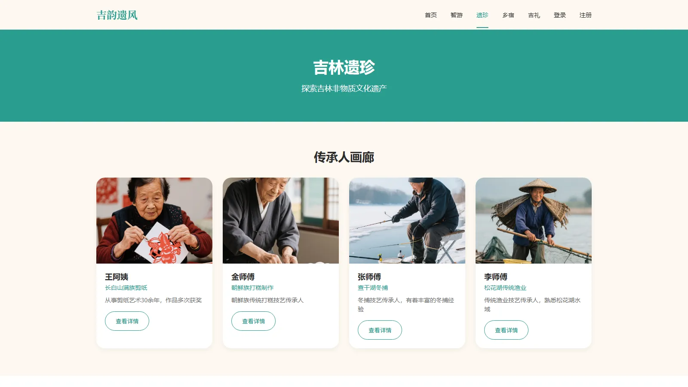
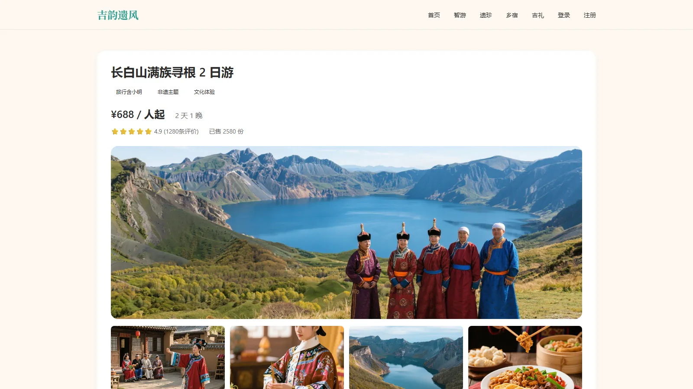
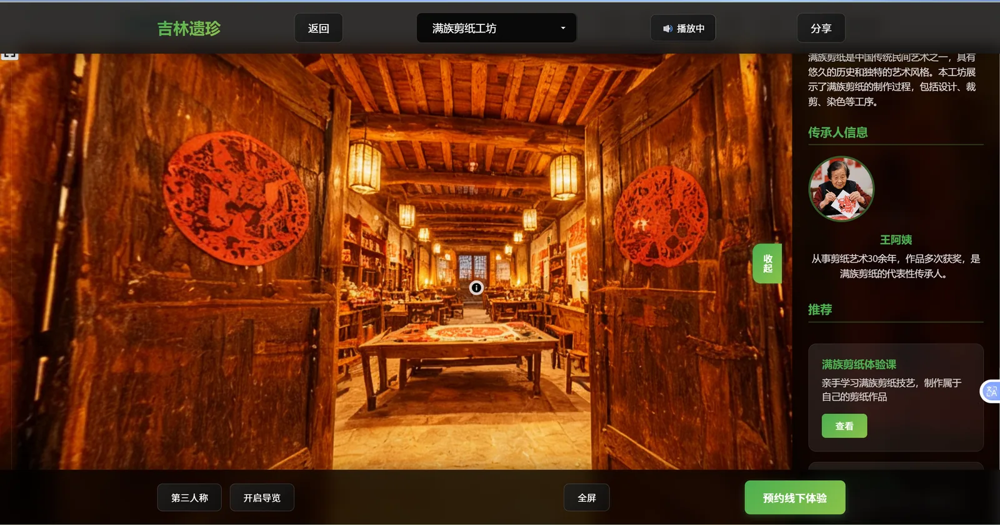
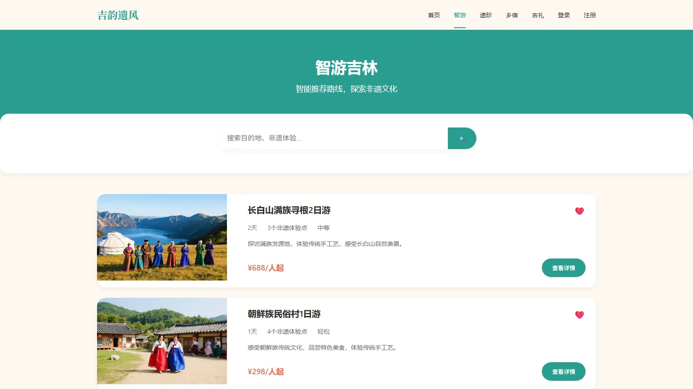
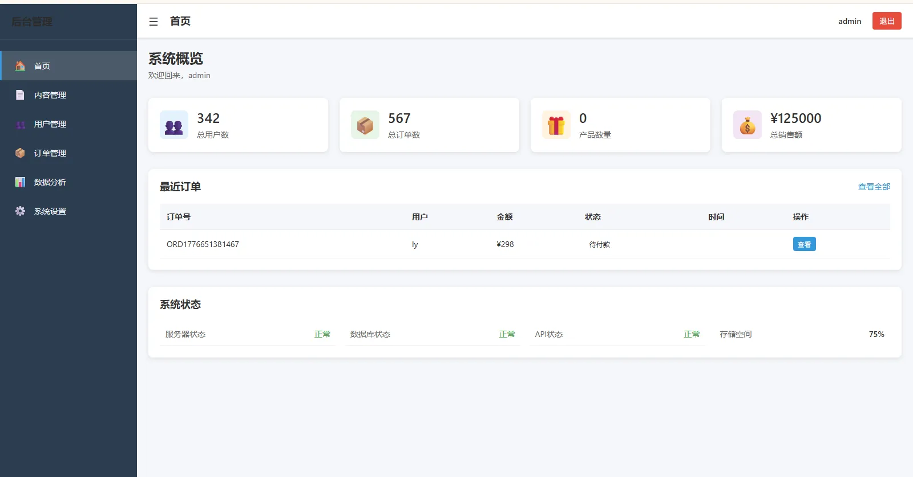

# 吉韵遗风 · HeritageJourney

面向吉林地区非物质文化遗产与文旅资源的 **Web 全栈平台**：把查干湖冬捕、朝鲜族民俗、松花湖、剪纸／雕刻等非遗项目和周边吃住行游，做成一条从前台浏览到下单、从内容运营到数据看板的完整链路。

> 参赛作品 · **中国大学生计算机设计大赛 国家级三等奖 / 省级一等奖**
> 前端 Vue 3 + Vite，后端 Django + SQLite，Nginx + Gunicorn 部署。

---

## 效果展示

<p align="center"></p>

<p align="center">
  
  
</p>

<p align="center">
  
  
</p>

<p align="center">
  
  
</p>

<sub>后台截图为演示数据；全景页右侧的传承人与乡宿推荐由内容库联动。</sub>

---

## 功能

### 前台（游客 / 用户）

| 模块 | 内容 |
|---|---|
| 首页与大屏 | 项目入口、地域分类导航、推荐位 |
| 非遗 | 项目列表 / 详情、非遗传承人、手作体验 |
| 文旅线路 | 线路列表、线路详情、行程与价格 |
| 景区活动 | 活动列表、活动详情（如查干湖开湖仪式） |
| 民宿 | 民宿列表、详情、体验笔记 |
| 商品 | 商品列表、分类详情（人参 / 大米 / 蜂蜜 / 泡菜 / 鱼 / 蛋 / 文创礼盒等） |
| 社区 | 游记、体验笔记、帖子 |
| 个人中心 | 登录注册、资料、头像、订单 |
| 特色交互 | **360° 全景漫游**（Pannellum）、**AR 互动页**（跳转 Kivicube 扫码体验）、冰钓小游戏、拼图小游戏、云工坊 |

### 后台管理（`/admin`）

登录 → 数据看板（Analytics）→ 内容管理 → 用户管理 → 订单管理。前端为独立的 Vue 管理端，后端复用同一套 `/api` 接口并叠一层 Django Admin。

---

## 技术栈

**前端**

- Vue 3（`<script setup>` SFC）+ Vite 8
- Vue Router 4（45 条路由）、Pinia 3
- Axios（统一 `baseURL: /api`，请求拦截注入 Token、响应拦截统一 401 跳登录）
- Pannellum 2.5.6（CDN 引入，全景图渲染）

**后端**

- Django 4.2（普通函数视图 + `JsonResponse`，未引入 DRF）
- django-cors-headers 跨域、Pillow 处理头像上传
- 认证基于 Django 自带 `AbstractUser`，扩展了 `phone / avatar / bio`

**部署**

- Gunicorn + systemd + Nginx 反向代理，静态与媒体文件由 Nginx 直出
- 详见 [DEPLOY.md](DEPLOY.md)

---

## 项目结构

```
.
├── backend/                 # Django 后端
│   ├── backend/             # 主配置（settings.py 开发 / settings_prod.py 生产）
│   ├── users/               # 用户与鉴权
│   ├── heritage/            # 非遗项目、传承人、体验
│   ├── tours/               # 文旅线路
│   ├── activities/          # 景区活动
│   ├── products/            # 商品
│   ├── homestay/            # 民宿与体验笔记
│   ├── community/           # 社区帖子、游记
│   ├── orders/              # 订单
│   └── manage.py
├── heritage-tourism/        # Vue 3 前端
│   ├── src/views/           # 前台页面
│   ├── src/admin/           # 后台管理端
│   ├── src/components/      # Navbar / Footer / PanoramaViewer 等
│   ├── src/api/             # 按业务拆分的 axios 封装
│   └── public/              # 全景图、配乐等静态资源
├── deploy/                  # systemd 服务文件、Nginx 配置
└── DEPLOY.md                # 服务器部署步骤
```

8 个业务 app、12 个数据模型、45 条前端路由。

---

## 快速开始

### 后端

```bash
cd backend
python -m venv venv
source venv/bin/activate        # Windows: venv\Scripts\activate
pip install -r requirements.txt
python manage.py migrate
python manage.py createsuperuser  # 可选，用于 /admin 后台
python manage.py runserver 8000
```

### 前端

```bash
cd heritage-tourism
npm install
npm run dev        # http://localhost:5173
```

Vite 已把 `/api` 代理到 `http://localhost:8000`（见 [vite.config.js](heritage-tourism/vite.config.js)），前后端分别起就能联调。

> ⚠️ 仓库含 7 段演示视频（148 MB）与 12 张全景图（60 MB），首次 clone 约 230 MB。只关心代码的话可以浅克隆：
> `git clone --depth 1 --filter=blob:none --no-checkout <repo> && cd <repo> && git sparse-checkout set '/*' '!heritage-tourism/src/assets/**' '!heritage-tourism/public/panorama/**' && git checkout main`

---

## 接口约定

所有业务接口挂在 `/api/` 下，按模块划分：`/api/users/`、`/api/heritage/`、`/api/tours/`、`/api/activities/`、`/api/products/`、`/api/homestay/`、`/api/community/`、`/api/orders/`。

返回体统一为 JSON，前端在 axios 响应拦截器里剥掉一层，页面直接拿到业务数据。

---

## 已知限制

写在这里，是为了让后面接手（或者面试时被问到）的人不用重新踩一遍：

1. **登录返回的是占位 Token。** `users/views.py` 的登录接口固定返回字符串 `mock-token`，真正的鉴权靠前端拦截器 + 后端 `@csrf_exempt`，并未实现 JWT。代码里有对应的 TODO。
2. **前后端未做真正的令牌校验。** 因此除 Django Admin 外，`/api` 下的写接口在拿到 URL 的情况下可以直接调用。
3. **`backend/db.sqlite3` 随仓库提交**，里面是演示数据，不是生产库。
4. **媒体资源直接进 Git**，占了仓库体积的 88%，这也是首次 clone 慢的原因。
5. **开发配置与生产配置分离**：`settings.py` 为 `DEBUG = True`、`ALLOWED_HOSTS = ['*']`，仅用于本地；线上走 `settings_prod.py`，`DEBUG = False` 且 `ALLOWED_HOSTS` 为白名单。

---

## 说明

本项目为课程／竞赛作品，内容素材（图片、视频、音频）用于教学演示，版权归原作者所有。
