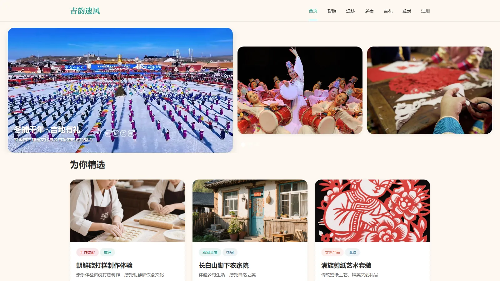
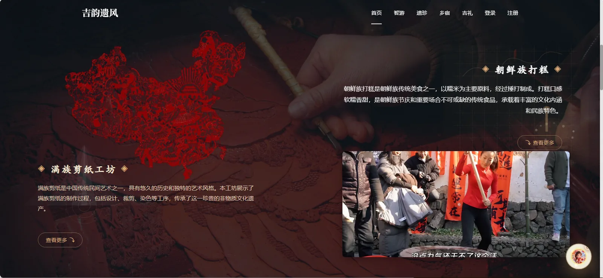
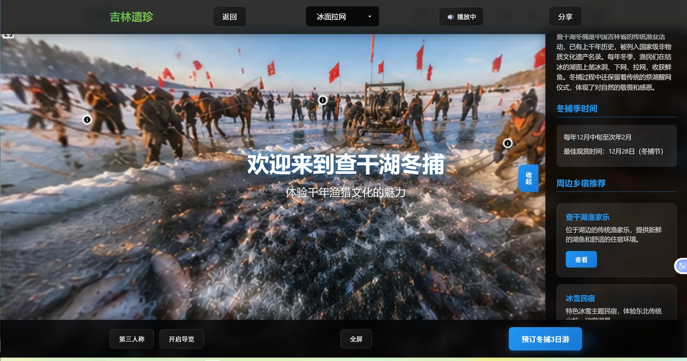

# 吉韵遗风 · HeritageJourney

面向吉林地区非物质文化遗产与文旅资源的 **Web 全栈平台**：把查干湖冬捕、朝鲜族民俗、松花湖、剪纸／雕刻等非遗项目和周边吃住行游，做成一条从前台浏览到下单、从内容运营到数据看板的完整链路。

**在线演示**：<http://hesitage.bhbigdata.com>

> 参赛作品 · **中国大学生计算机设计大赛 国家级三等奖 / 省级一等奖**
> 前端 Vue 3 + Vite，后端 Django 5.1 + DRF + MySQL，JWT 鉴权，接入大模型对话。

---

## 效果展示

<p align="center"></p>

<p align="center"></p>

<p align="center">
  
  
</p>

<p align="center"></p>

<sub>后台截图为演示数据；全景页右侧的传承人与乡宿推荐由内容库联动。</sub>

---

## 功能

### 前台（游客 / 用户）

| 模块 | 内容 |
|---|---|
| 首页与大屏 | 三屏轮播、地域分类导航、智能推荐位 |
| 非遗 | 项目列表 / 详情、非遗传承人、手作体验 |
| 文旅线路 | 线路列表、线路详情、逐日行程、费用说明、评价 |
| 景区活动 | 活动列表、活动详情（如查干湖开湖仪式） |
| 民宿 | 民宿列表、详情、体验笔记 |
| 商品 | 商品列表、分类详情（人参 / 大米 / 蜂蜜 / 泡菜 / 鱼 / 蛋 / 文创礼盒等） |
| 社区 | 游记、体验笔记、帖子 |
| 个人中心 | 注册登录、资料、头像、订单 |
| 特色交互 | **360° 全景漫游**（Pannellum）、**AI 导览助手**、**AR 互动页**（跳转 Kivicube 扫码体验）、冰钓小游戏、拼图小游戏、云工坊 |

### 后台管理（`/admin`）

登录 → 数据看板（Analytics）→ 内容管理 → 用户管理 → 订单管理。前端为独立的 Vue 管理端，走 JWT 鉴权；后端同时保留 Django Admin。

---

## 技术栈

**前端**

- Vue 3（`<script setup>` SFC）+ Vite
- Vue Router（50 条路由）、Pinia
- Axios：统一 `baseURL: /api`，请求拦截注入 JWT，响应拦截统一处理 401 跳登录；`VITE_DEV_MODE` 开关用于本地免鉴权调试
- Pannellum 2.5.6（CDN 引入，全景图渲染）

**后端**

- Django 5.1 + Django REST Framework
- **JWT 鉴权**：`djangorestframework-simplejwt`，`/api/token/` 签发 access / refresh
- **MySQL 8**（`mysqlclient`，`utf8mb4`）+ `django-filter`
- `python-dotenv` 加载 `.env`：密钥、数据库密码、模型 Key 都不写进代码
- **AI 对话**：`ai` 模块用 `urllib` 直连 SiliconFlow 的 OpenAI 兼容接口，`StreamingHttpResponse` 把 token 流式吐给前端
- Pillow 处理头像上传

**部署**

- Gunicorn（或 `runserver`）+ systemd + Nginx 反向代理，静态与媒体文件由 Nginx 直出
- 详见 [DEPLOY.md](DEPLOY.md)

---

## 项目结构

```
.
├── hesitage-backend/        # Django 后端
│   ├── backend/             # 主配置（settings.py / urls.py）
│   ├── users/               # 用户与 JWT 登录
│   ├── tours/               # 文旅线路（逐日行程、时段、费用、评价）
│   ├── products/            # 商品与评价
│   ├── homestay/            # 民宿与体验笔记
│   ├── community/           # 社区帖子、游记
│   ├── orders/              # 订单
│   ├── ai/                  # 大模型对话（流式）
│   ├── media/               # 上传与内容图片
│   ├── heritage-backend.service
│   └── manage.py
├── heritage-tourism/        # Vue 3 前端
│   ├── src/views/           # 前台页面
│   ├── src/admin/           # 后台管理端
│   ├── src/components/      # Navbar / PanoramaViewer / ChatPanel 等
│   ├── src/api/             # 按业务拆分的 axios 封装
│   └── public/              # 全景图、图片等静态资源
├── deploy/nginx.conf        # Nginx 配置
└── DEPLOY.md                # 服务器部署步骤
```

6 个业务 app + `ai` 模块、17 个数据模型、26 个序列化器。

---

## 快速开始

### 后端

```bash
cd hesitage-backend
python -m venv venv
source venv/bin/activate          # Windows: venv\Scripts\activate
pip install -r requirements.txt

cp .env.example .env              # 填 MySQL 密码和 SiliconFlow Key

mysql -u root -p -e "CREATE DATABASE heritage_db CHARACTER SET utf8mb4 COLLATE utf8mb4_unicode_ci;"
python manage.py migrate
python manage.py createsuperuser  # 可选，用于 /admin 后台
python manage.py runserver 8000
```

### 前端

```bash
cd heritage-tourism
npm install
npm run dev        # http://localhost:5173
```

Vite 已把 `/api` 代理到 `http://localhost:8000`（见 [vite.config.js](heritage-tourism/vite.config.js)），前后端分别起就能联调。

> ⚠️ 仓库含演示视频、全景图和内容图片，合计约 437 MB，首次 clone 会很慢。只看代码可以浅克隆：
> `git clone --depth 1 --filter=blob:none --no-checkout <repo> && cd <repo> && git sparse-checkout set '/*' '!heritage-tourism/src/assets/**' '!heritage-tourism/public/**' '!hesitage-backend/media/**' && git checkout main`

---

## 接口约定

业务接口挂在 `/api/` 下，按模块划分：`/api/users/`、`/api/tours/`、`/api/products/`、`/api/homestay/`、`/api/community/`、`/api/orders/`、`/api/ai/`。

鉴权走 JWT：

| 接口 | 用途 |
|---|---|
| `POST /api/token/` | 用户名密码换 access + refresh |
| `POST /api/token/refresh/` | 刷新 access |
| `POST /api/token/verify/` | 校验 token |

`/api/ai/chat/` 是 POST，请求体 `{"messages": [...]}`，返回 `text/event-stream` 形式的流式响应。

---

## 已知限制

写在这里，是为了让后面接手（或者面试时被问到）的人不用重新踩一遍：

1. **仓库里只有一份 `settings.py`，是开发配置**：`DEBUG = True`、`ALLOWED_HOSTS = ['*']`、`CORS_ALLOW_ALL_ORIGINS = True`。线上必须单独收紧，目前是靠部署时改代码，没有拆出 `settings_prod.py`。
2. **敏感配置已全部改为读环境变量**：`DJANGO_SECRET_KEY`、`MYSQL_PASSWORD`、`SILICONFLOW_API_KEY` 都在 `.env` 里，仓库只提交 `.env.example`。
3. **AI 对话有两条链路没统一**：后端 `ai` 模块提供 `/api/ai/chat/`，而前端 `ChatPanel.vue` 默认连的是 `VITE_CHAT_API_BASE_URL`（`localhost:3000`）上的另一个服务。
4. **`heritage` / `activities` 两个 app 在本版本中已移除**，非遗页面的数据改为前端静态数据；`src/api/heritage.js`、`src/api/activities.js` 还在但已无对应后端接口。
5. **媒体资源直接进 Git**（视频 + 全景图 + 内容图），是 clone 慢的主要原因。
6. **后台管理页会渲染前台导航条**：`/admin` 路由没有与前台布局隔离，顶部会盖一层 Navbar。

---

## 说明

本项目为课程／竞赛作品，内容素材（图片、视频、音频）用于教学演示，版权归原作者所有。
